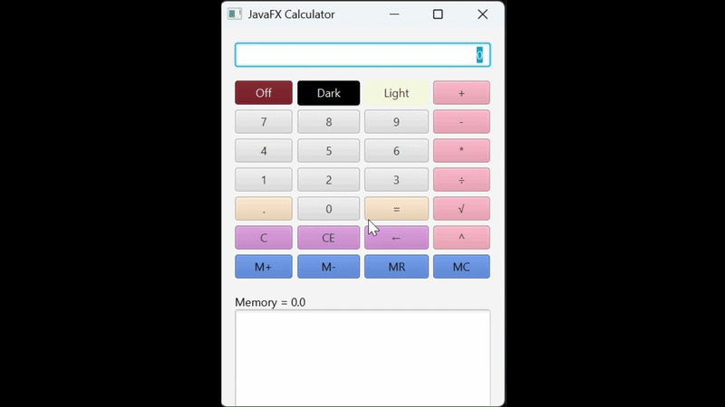

<!-- 
https://github.com/lifeparticle/Markdown-Cheatsheet
https://youtu.be/eVGEea7adDM?si=cz1Fbqxr9VgioIEh
-->

# Java Fx Calculator App

<b>Table of Content</b>
- [Summary](#summary)
- [How the Program Works](#how-the-program-works)
- [Console Output Example](#console-output-testing-example)
   - [Calculator Demo](#calculator-demo)
- [New Concepts](#new-concepts)
- [Maintainers](#maintainers)

## Summary
The JavaFX Calculator App is a graphical user interface (GUI)-based calculator built using JavaFX. 
This project allows users to interact with buttons, text fields, and layouts.

The calculator performs standard arithmetic operations along with advanced functions such as exponentiation,
square root, and memory operations (M+, M-, MR, MC). It also includes theme customization (Dark/Light mode)
and a calculation history panel.
## How the Program Works
1. Application Launch
- The program extends the Application class
- Execution begins in the start(Stage primaryStage) method
- A Scene is created and displayed using a Stage (window)
2. User Interface Layout

The UI is structured using JavaFX layout managers:

- BorderPane
    - Top → Display (TextField)
    - Center → Buttons (GridPane)
    - Bottom → Memory + History (VBox)
- GridPane 
    - Organizes 28 buttons in a grid layout
    - Buttons include numbers, operators, memory, and special functions
- VBox
    - Memory display (Text)
    - Calculation history (TextArea)
3. Performing Calculations
- User clicks number buttons → builds input string (inStr)
- User selects an operator (+, -, *, ÷, ^, √)
- Program stores:
    - Current result
    - Last operator
- When = is pressed:
    - compute() method executes the operation
    - Result is displayed
    - Expression is added to history
- Memory Functions
    - M+ → Adds current value to memory
    - M- → Subtracts from memory
    - MR → Recalls memory value to display
    - MC → Clears memory
5. Calculation History (Extra Credit Feature)
- Implemented using a TextArea
- Displays full expressions 
- Automatically updates after each computation
6. Theme Customization
- Dark Mode
    - Changes background and text colors
- Light Mode
    - Resets UI to default appearance
- Uses JavaFX CSS styling via setStyle().
7. Additional Features
- Backspace (←) → Removes last digit
- CE (Clear Entry) → Clears current input only
- C (Clear) → Resets entire calculation
- Off → Exits application

## Console Output Testing Example
## Calculator Demo

## New Concepts
- Java Fx Framework

- Stage → Scene → Layout → Controls

- Controls
  - TextField → Displays input/output
  - Button → User interaction
  - TextArea → Calculation history
  - Text → Memory display
- Layout Managers
  - BorderPane → organizes UI into regions
  - GridPane → structured button layout
  - VBox → vertical stacking of elements
- Use of EventHandler and Lambda Expressions
## Maintainers
[@suna2km](https://github.com/suna2km) Suna Aregay                                                                                                                        
[Back to Top](#java-fx-calculator-app)